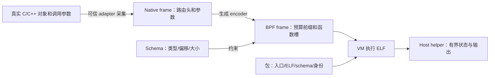

# ABI 心智模型：一次调用经过哪些表示

ABI 是双方对“怎样解释这些字节、怎样调用、谁保持内存有效”的约定。Fingolfin 至少有模型类型布局、SDK 原生调用帧、BPF 执行帧、schema 描述和包格式几层约定。不要把它们看成同一个 struct 的不同文件名。

## 1. 从语义值到执行字节

真实目标可能使用类、模板、指针、内部枚举；模型只暴露选定的固定宽度值。转换发生在 adapter 边界，不能把任意宿主类的内存 memcpy 到模型 struct 后认为它们等价。

## 2. 类型一致有两种含义

**名义一致**说明“这是哪个模型声明的类型、属于哪个入口签名”；**结构一致**说明“每个字段的大小、对齐和偏移是什么”。两个 struct 恰好都是 16 字节，不代表一个可以替代另一个。例如 Core 的设备和坐标字段，不能与任意两个 u64 的结构交换。

当前布局 profile 是 Linux x86-64 小端，指针为 8 字节、bool 用 1 字节表示，整数宽度固定。struct 按声明顺序和自然对齐布局；enum 有明确整数表示；固定数组按元素布局排列。C/C++ ABI 声明带大小、对齐和偏移断言。数组按值参数/返回需包装，以避免 C 参数退化为指针的语义变化。

布局断言只能验证编译器如何排列字段，不能证明填进去的 device 真来自当前设备，也不能证明地址仍有效。

## 3. Native frame 面向路由

Native frame 的开头是 FgCallHeader，随后是生成的 arg0、arg1 等原生参数字段。头部用来回答“这帧属于哪个 ABI、哪个 hook、哪个路由快照和哪个对象”。

| 原生头字段 | 含义 | 正确来源 |
| --- | --- | --- |
| abi_version | 调用帧协议版本 | FG_ABI_VERSION |
| frame_bytes | 整个 native frame 的字节数 | sizeof 生成的 native frame |
| hook_id | 本地可信 hook 编号 | 当前 lease |
| config_generation | 本次路由发布代际 | 当前 lease.generation |
| object | 完整 ObjectKey | 当前 lease.object |

SDK v2 指的是 lease 接口版本；它使用的 FgCallHeader 仍为 ABI version 1。接口版本、帧版本、schema 版本和包版本独立，不应全部填 2。

config_generation 与 object.generation 含义不同：前者区分路由快照，后者区分对象槽复用。select 可在同一对象上发布新路由，所以前者变化而后者不变；对象重建则需要新键。构帧直接复制 lease 的信息，避免用控制器“此刻最新值”替代已经取得的旧快照。

## 4. BPF frame 面向函数执行

BPF frame 的前 16 字节为 `steps:u64`、`max_depth:u32`、`error:u32`，后面按 schema 排列参数、where 绑定槽以及可选返回槽。它不以 FgCallHeader 开头。Attachment 在执行准入后写入预算前缀；encoder 填入值并清零输出/padding。

函数的返回槽与 Host emit 是两条通道：返回槽属于这一次函数调用，emit 写入有界 FIFO。普通函数有返回类型不代表目标 SDK 自动把它当宿主 API 返回值，也不代表可以借此改变目标原始运算。

### 一个实际布局例子

教程程序 `record(slot:u32,n:u64)` 的当前生成布局为：

| 内容 | Native frame 偏移 | BPF frame 偏移 |
| --- | --- | --- |
| ABI 版本、frame 字节数 | 0、4 | 不存在 |
| hook ID、路由代际 | 8、16 | 不存在 |
| ObjectKey 四个 u64 | 24～55 | 不存在 |
| 执行 steps/depth/error | 不存在 | 0、8、12 |
| arg0：slot u32 | 56 | 16 |
| 对齐 padding | 60～63 | 20～23 |
| arg1：n u64 | 64 | 24 |
| 总大小/对齐 | 72 / 8 | 32 / 8 |

因此将 native 指针强转为 BPF frame 会把 ABI 版本等字节读成预算，把路由信息读成函数参数。表格是这个具体生成签名的示例，不是可硬编码到任意入口的通用偏移。

## 5. Encoder 为什么是必要边界

生成 encoder 检查 native 大小、ABI、目标 frame 大小和预期 schema，清零目标并按字段复制参数，随后验证输入表示。控制器仍需提供合法、足够长、存活的 native 输入内存；C 指针不是能自动验证实际分配长度的安全句柄。

输入输出不能重叠。factory 的 frame 存储必须持续到同步 dispatch 返回；不能返回已结束栈帧中的局部对象。多订阅可共用同一次 native frame，但各自使用自己的编码/执行存储。

生成 adapter 当前按“一个翻译单元一个 adapter”组织，通用的 FgNativeFrame/FgBpfFrame 名称会冲突。多入口集成应像现有分组 adapter 一样隔离编译单元，再由控制器统一调度，不要把多个生成头直接堆入同一个 C 文件。

## 6. Schema 是布局说明，不是数据本身

schema 使用可校验的二进制描述记录 frame 大小、alignment、类型节点、成员偏移、参数/binding/result 槽及名字。它自身是固定小端 wire 格式，没有原生指针和隐式 padding，可从非对齐字节读取。执行 frame 则按 schema 描述的对齐布局存储值；这两种“字节格式”不能混为一谈。

C runtime 不通过解析 C 头文件猜布局，而通过 schema 确定槽。schema 校验拒绝越界、非法类型、循环、重叠、不合规对齐和超限资源。通过结构校验不意味着任意 ELF 都真的遵守它，所以 ELF/schema 必须从同一经过完整性与身份校验的包中选择。

wire 字段和资源上限见 [schema 参考](frame-schema.md)；一般接入者使用生成 encoder，无需手写二进制 schema。

## 7. 指针表示不等于内存访问能力

模型可描述 opaque pointer 的 ABI 值；schema 中它是 8 字节表示。这不授予 VM 解引用任意目标地址的权限，不编码借用寿命，也不把该地址变成 ObjectKey。参考 evaluator 不读取目标地址。

需要采集目标缓冲内容时，应先设计受控的复制/读取机制，说明长度、上限、同步和失败语义，再考虑语言接口。当前没有“声明一个指针就能安全遍历所有目标内存”的功能。能按值复制的小型标量/record 优先按值采集。

## 8. 五类版本与身份

| 标识 | 检查的契约 |
| --- | --- |
| SDK v2 | acquire/lease/dispatch/release 接口 |
| FgCallHeader ABI 1 | 原生路由帧头 |
| frame schema v1 | 机器可读布局描述 |
| 开发 `.fgo` v3 | 包组织与完整性字段 |
| 模型/程序内容哈希 | 本次编译输入与模型契约 |

此外还有 Session generation、配置身份、ObjectKey generation 和路由 generation，它们是运行生命周期控制，不是文件格式版本。哈希一致也不是作者认证；结构一致也不是能力授权。

## 9. 修改接口时怎样处理

| 修改 | 应采取的动作 |
| --- | --- |
| 参数类型、顺序或 struct 字段变化 | 重新检查模型/程序，重建包和 adapter，重编宿主接入，验证新布局 |
| 仅 availability 改变 | 模型身份仍改变；重建谓词、facts 配置和相应生成物 |
| 仅程序体改变 | 重建包；保持与使用的入口/生成物身份一致，验证 helper 需求和容量 |
| 探针采集或回调 ABI 改变 | 重建目标 DSO/调用者，处理缓存，做真实采集对照 |
| 仅 enable mask 改变 | 通过路由 select 发布，旧 lease 按旧快照完成 |

不要靠手改哈希、禁用断言或强制类型转换压掉不兼容。先确认冲突发生在语义类型、native frame、BPF frame、包还是路由身份层。可运行演示见 [C 教程](c-walkthrough.md)。
