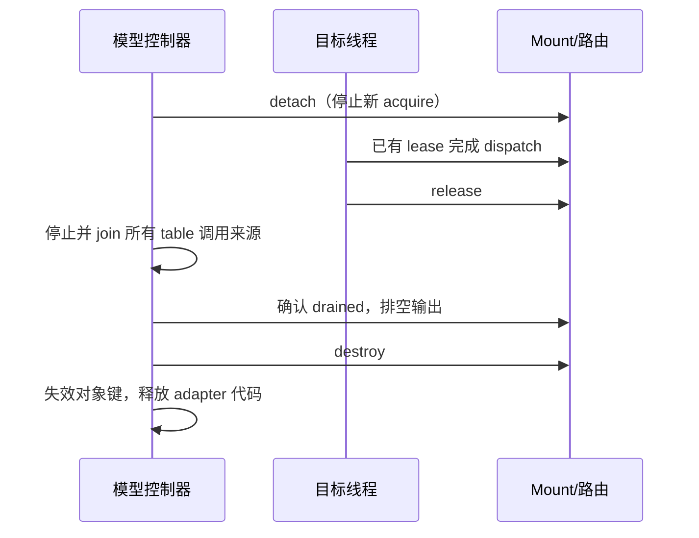

# C/C++ 目标接入

概念与设计方法先读 [建模指导](modeling-guide.md)，本页提供具体实现约束与操作。

C++ cmodel 可调用 C SDK；运行时、控制器和 Host 仍使用 C11。以下步骤描述目标进程内接入，独立 stdio Agent 的 LOAD 不会自动完成这些步骤。

## 构建层次

| 配置 | 依赖与产物 |
| --- | --- |
| 默认 `runtime` | C11、pthread；基础 `libfingolfin.a` |
| `FG_WITH_PACKAGE=ON` | json-c、OpenSSL；包加载和 `fgctl` |
| `FG_WITH_UBPF=ON` | 锁定 uBPF checkout/build；VM 执行 |
| 两者同时启用 | Program/Attachment/binding、Agent/Mount 和 `fg-agent` |
| `FG_UBPF_SCRATCH=ON` | 已应用本仓库 safe-scratch patch 的 uBPF；预分配执行 scratch |

```sh
cmake -S runtime -B build/full \
  -DFG_WITH_PACKAGE=ON -DFG_WITH_UBPF=ON -DFG_UBPF_SCRATCH=ON \
  -DFG_UBPF_ROOT=/path/to/ubpf -DFG_UBPF_BUILD=/path/to/ubpf-build \
  -DBUILD_TESTING=OFF
cmake --build build/full -j 2
```

外部版本与准备方式见 [uBPF 集成](../integration/ubpf/README.md)。启用完整测试还需提供生成的 ELF/包/adapter，见 [开发指南](development.md)。

## 接入顺序

1. 定义模型包的对象路径、hook 签名和固定宽度类型；只有具备稳定性保证的属性才声明提前可用阶段。
2. 用 `fingolfin build` 生成 `.fgo`，用 `emit-adapter` 生成对应原生帧和 encoder。模型与程序源码身份必须一致。
3. 创建 C Session 并加载 Program。为实际目标对象分配完整 ObjectKey，不用宿主地址充当持久身份。
4. 提供可信 hook ID 映射、native frame 大小、encoder、Host 配置和预算，调用 `fg_mount_create` 或 `fg_mount_create_many`。
5. 在目标 API 处通过 SDK v2 获取 lease；frame factory 只在至少一个订阅允许时执行。不要绕过 lease 独立调用门控和 dispatch。
6. 排空输出并检查各层返回状态。结束时 detach、drain、destroy，再失效对象键。

## 属性与状态

provider 必须在整个 facts collection 期间持有一致模型快照，检查完整父链，未知值不得冒充 0。Mount 复制 facts 与 gate；更新需要新的路由配置和旧 lease 排空。helper 失败不回滚已完成操作，调用方应按明确定义的错误策略继续或停止。

## 参考

- [SDK 接口](../sdk/README.md)、[路由并发契约](c-routing.md)。
- [Session/Mount](../agent/README.md)、[对象身份](runtime-objects.md)。
- [调用帧 schema](frame-schema.md)、[属性阶段](model-availability.md)。
- [tt-emule 接入实例](tt-emule.md)。

## 先运行一个完整实例

[端到端 C 教程](c-walkthrough.md) 提供可编译源码、CMake 和确定的输出，用同一套 Session/Mount/SDK API 完成两次观测。建议先运行它，再把 factory 和对象身份替换成自己的 cmodel。依赖准备与完整测试命令见 [构建指南](build.md)。

## 配置字段如何填写

| 字段 | 来源与约束 | 常见错误 |
| --- | --- | --- |
| version / struct_bytes | 对应公共头文件常量、当前结构 sizeof | 将不同版本结构直接传入 |
| program_id | Session LOAD reply | 假设永远为 1 |
| function | 包中的全限定函数名，例如 program::record | 只写 record 或拼错模块 |
| hook | 可信模型 adapter 的本地映射 | 接受远端包指定的任意宿主入口 |
| native_frame_bytes | 生成的 FgNativeFrame 大小 | 使用 BPF frame 大小 |
| encode | 同源生成的 fg_generated_encode | 跨模型复用旧 encoder |
| attachment.identity.program | 与 program_id 相同 | 混用包哈希和注册表编号 |
| attachment.identity 的其余字段 | 控制器配置与对象键 | 用地址代替生命周期身份 |
| step_budget / depth_budget | `.fg` 执行步数和调用深度限制 | 以宿主超时替代执行预算 |
| instruction_limit | VM 指令限制 | 与语言步数混为一谈 |
| allowed_helpers | `1u << helper_id` 位集合 | 将 ID 1、2 写成位 0、1 |
| host | 预分配 counters/maps/histograms/output | 未声明程序访问的 slot |
| gate | 可选的可信计划、facts 和预算 | unknown 当 false 或当 0 |

helper 1 和 2 的掩码是 `(1u << 1) | (1u << 2)`，即 6。容量和预算应由目标控制器决定；包声明所需能力不等于自动授予能力。诊断缓冲区可传给 create/apply，以保留拒绝装载的原因。

## 模型 adapter 的边界

adapter 负责把宿主对象和函数调用映射到模型。它应回答四个问题：此对象属于哪个 run/launch；是否仍存活；此 hook 的参数采集是否忠实；对象属性在什么阶段保持不变。模型声明只是接口契约，不能替代实际的数据提供者。

按值参数适合小型身份和标量，例如 Core、Observation。宿主指针不是持久身份，也不是安全的自动解引用能力；需要读取目标内存时必须另行设计受控接口，不能在生成 frame 时偷偷保留易失指针。

每个观测点都应标明是进入还是退出、哪些参数真正被采集、异常时是否能产生退出事件。参数被声明成地址不代表已经验证该地址的内容。

## 多订阅与动态选择

`fg_mount_create_many` 一次配置 1～64 个订阅，全部成功才发布；失败不留下半个可见 Mount。所有条目必须共享 hook、ObjectKey 和 native frame 大小，调用方还必须确保布局语义一致。每个输入条目各有自己的 Attachment/Host，重复 program/configuration 身份不会自动共享计数器。

输入序号决定 enable mask 的位：`1` 启用第 0 项，`2` 启用第 1 项，`3` 启用前两项，`0` 暂停全部。调用 `fg_mount_select(mount, expected_generation, mask, &new_generation)` 原子发布替换路由。旧 lease 使用旧快照完成；新 acquire 使用新快照。暂停后重新启用保留已有 Host 状态。

select 不新增订阅、不重载程序、不刷新 facts；需要这些变化时应准备新的配置并安排旧 Mount 退役。最多保留八个尚未回收的替换路由快照；持有旧 lease 太久会使更新返回 CAPACITY，当前活跃路由保持不变。释放旧 lease 后调用 collect 回收，再重试更新。CONFLICT 表示 expected_generation 已过期，应重新读取并重新决定，不能盲目覆盖并发控制决策。

## 并发约定

控制器对 Session 和 Mount 控制操作串行化；目标线程通过 SDK 调用。一个 Attachment 同时只允许一个执行，重入/并发冲突返回 BUSY。不能在返回 BUSY 后假装观测成功，也不应在目标热点无界自旋。应用可记录丢弃、稍后重试或停止该批次，必须选择一种明确策略。

基础容器/Host 没有替调用者加锁。Mount 封装的读写通过其拥有者协调；直接使用 FgHost 的程序需自己同步。对象 provider 必须在整个 collect 的多次读取之间保持一致快照，而不仅仅为每个单次读取加锁。

## 失败时如何释放

| 失败位置 | 已经拥有的资源 | 后续处理 |
| --- | --- | --- |
| 读取包失败 | 文件/输入缓冲 | 关闭文件、释放输入；尚无目标挂载 |
| LOAD 失败 | Session | 保存诊断，可重新发合法请求或销毁 Session |
| Mount create 失败 | Session 中 Program | out 为 NULL，无已发布路由；可保留或卸载 Program |
| observe/某 helper 失败 | 活跃 Mount，可能有已提交状态 | 检查 report 和输出，按策略继续或 detach |
| select CAPACITY | 原活跃路由及旧快照 | 等旧 lease 释放、collect 后再试 |
| destroy BUSY | 完整 Mount | 保留对象，排空后重试，不能 free 外层存储 |

程序整体不具备事务回滚。例如 counter_add 成功而 emit 因队列满失败，counter 已增加；多订阅中一个失败也不撤销其他订阅。记录执行状态与业务结果时应保留这种“部分提交”的区别。

## 结束顺序



上图假设应用能停止或同步调用来源；若无法 join，应使用等效的外部生命周期协议。`FgRuntimeV2` 是借用 table，不会单独延长 Mount 的寿命。更细的 acquire/lease 语义见 [路由契约](c-routing.md)。
