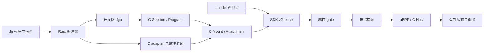

# 架构与执行链

概念与设计方法先读 [工作原理](principles.md)，本页提供具体实现约束与操作。

用户态组件采用 C，编译器与 `.fg` 语言保留 Rust 实现。Python 仅用于构建、测试和报告生成。

## 编译

`source` 确定性发现模型模块；`resolve` 收集声明并处理导入；`types` 与 `sema` 检查布局、签名、函数体和模式；`ir` 降低类型化操作与分阶段 gate；`codegen` 生成 C/BPF 和 adapter；`build` 调用 Clang 后原子发布包。模型属性阶段契约参与内容哈希，未声明的读取保留 Invocation 阶段。

Rust 的 `eval`、`pattern`、`runtime` 和可选 VM 桥接用于语义对照与开发测试，不是目标端 C 组件的链接依赖。

## 所有权

| 对象 | 所有者与生命周期 |
| --- | --- |
| Program | 不可变包与入口，引用计数保活 |
| Session | 注册程序，分配会话内 ID；卸载不等于解绑 Mount |
| Mount | 目标控制器拥有，组合 Attachment、Host、binding 和 Port |
| ObjectKey | run/launch/slot/generation，区分对象与槽复用 |
| lease | 固定路由代际，覆盖 gate、构帧、dispatch 和回收边界 |
| facts | 与完整身份绑定的复制快照；发布后不可变 |

目标销毁顺序为停止新获取 → detach → 等待全部 lease 排空 → 处理剩余输出 → destroy Mount → 失效模型对象。销毁还需要排除所有新的 SDK 表调用；仅观察租约数量不足以证明指针无人使用。

## 目标接入与控制通道

嵌入目标的 C 控制器拥有实际对象和 Mount。独立 `fg-agent` 当前提供程序注册的 stdio 会话；`fgctl` 可检查包、启动通道、加载/卸载/查询程序。远端 LOAD 不会自动挂载到目标模型。

## tt-emule 实例

39 个 API 点将事件送入生成 adapter。控制器按 launch → device → core → CB/NOC/compute 注册身份，为对象/hook 创建 Mount。设备身份来自执行 fiber 的 chip ID；`.fg` 可读取按值 Core.device。身份 provider 支持父链检查与属性快照；显式 CB 策略可在获取 lease 时筛掉不匹配对象。

当前集成用全局 mutex、首次观测注册和惰性 Mount 创建，侧重正确性。性能范围与未支持项见 [能力范围](development-status.md)。

## 一次观察从哪里来、到哪里去

以 CB push 为例，目标 API 的探针先捕获实际设备、核心和 CB 参数。模型控制器将这些值映射为完整对象键和可信 hook ID；SDK acquire 固定当前路由快照，并对各订阅做提前 gate。没有订阅通过时直接返回，不构造 native frame。

至少一个订阅通过时，factory 生成一次公共 native frame。每个 binding 用同源 encoder 转成自己的 BPF frame，Attachment 校验身份和执行准入，执行器运行 ELF，Host 承接 helper 修改有界状态。输出消费者读取 FIFO 并记录程序/对象/批次上下文。已有 lease 释放后，旧路由快照才可回收。

此链条中有三种容易混淆的标识：源码/模型哈希说明编译输入；Session program_id 说明注册项；ObjectKey 与路由 generation 说明目标实例和发布快照。它们服务不同失效边界，不能互相代替。

## 控制路径与观察路径的资源分工

| 阶段 | 允许的工作 | 主要所有者 |
| --- | --- | --- |
| 离线编译 | 模型解析、检查、Clang、产物写入 | Rust 编译器 |
| 装载/准备 | 包解析、验证、VM 和容器分配、facts 收集 | C 控制器/Program/Attachment |
| 路由发布 | 已准备订阅的代际检查与快照替换 | Mount/Port |
| 观察 | acquire、gate、按需 frame、预算执行、helper | SDK/binding/Attachment |
| 收集 | counter/records 读取、错误处理 | C 输出消费者 |
| 退役 | detach、等引用排空、销毁、对象失效 | 模型控制器 |

这是组件职责划分，不是当前 tt-emule 热路径零分配的声明。tt-emule 正确性控制器在首次事件时惰性创建对象和 Mount，包含装载/分配；若要做性能化接入，应把可预知资源移至显式准备阶段，并单独测量。

## 在源码中从哪一层开始找

| 要理解/修改的内容 | 入口 |
| --- | --- |
| CLI 参数与编译流程 | `src/main.rs`、`src/compiler.rs` |
| 模型发现与导入 | `src/source.rs`、`src/resolve.rs` |
| 类型、模式与函数语义 | `src/types.rs`、`src/sema.rs`、`src/pattern.rs` |
| 生成与 IR | `src/ir.rs`、`src/codegen.rs` |
| 公共 C 契约 | `runtime/include/fingolfin/` |
| C 控制会话与挂载 | `agent/src/session.c`、`agent/src/mount.c` |
| 目标调用接口 | `sdk/include/` |
| 实际模型声明 | `models/tt_emule/src/` |
| 实际对象/provider/策略接入 | `integration/tt-emule/dynamic-model-runtime/` |

修改某层前先读它的公共契约和最近测试，不要仅从调用点推断所有权。细节分别在 [C 教程](c-walkthrough.md)、[对象](runtime-objects.md)、[路由](c-routing.md)、[调用帧](frame-schema.md) 和 [属性阶段](model-availability.md)。
