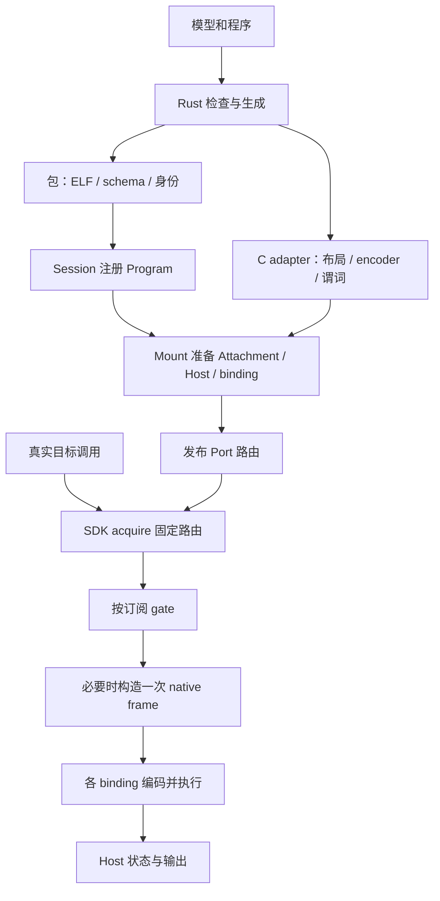

# 工作原理：从模型契约到一次观测

Fingolfin 让目标程序在指定调用点运行有界的观测逻辑。模型描述“有哪些对象、哪些事件、哪些值可读”；`.fg` 程序描述“选中什么、计算什么、记录什么”；C adapter 将真实目标接到这些声明上；C 运行时管理发布、执行、状态与回收。Rust 编译器负责离线检查和生成，目标进程不需要链接 Rust。

阅读顺序建议为本章 → [对象模型](object-model.md) → [ABI 心智模型](abi-model.md)。随后按 [建模指导](modeling-guide.md) 接入目标，按 [观测指导](observation-guide.md) 设计实验。这几章说明使用者需要理解的契约；源码链接只用于进一步验证，不是理解前提。

## 1. 三种描述各自回答什么

| 描述 | 回答的问题 | 不会自动完成的工作 |
| --- | --- | --- |
| 模型包 | 什么对象拥有这个 hook？参数与属性是什么类型？属性何时稳定？ | 找到宿主对象、安装探针、读取属性 |
| 观测程序 | 什么对象匹配？一次调用执行哪些计算和 helper？ | 分配 Host 容量、决定宿主线程同步方式 |
| C adapter/控制器 | 这个真实调用对应哪个对象和 hook？值从哪里取？何时失效？ | 自动证明模型声明真实、替应用选择丢弃/重试策略 |

例如 CB push：模型声明 CB 归属 device/core，并声明 push 参数；程序统计设备 1 的 CB0 进入次数；adapter 从真实执行 fiber 取设备、从调用参数取 CB 编号和页数。若 adapter 用宿主线程编号冒充设备，类型检查可能仍通过，但观测语义已经错误。

## 2. 编译为何需要模型

编译器先检查模型，再将程序与模型核对：hook 必须存在，参数类型和次序必须一致，where 路径必须能从对象关系中解释。随后产生类型化 IR、阶段 gate、BPF ELF、调用帧 schema 和 C adapter。编译期能拒绝拼错属性和错误宽度，却无法证明宿主实际调用了正确探针。

`.fgo` 将一个程序的入口、ELF、schema、签名及输入身份组织在一起。它是当前开发格式；加载校验检查内容和结构，但不授予任意宿主能力。hook 映射、helper 允许集、对象身份与预算仍由可信 C 控制器提供。

生成物需要作为同一组使用。修改模型类型或 availability 后，应重建程序和 adapter；不能只更新 ELF 并保留旧 encoder。源码身份变了不一定意味着字节布局变了，但仍意味着旧的语义契约不能直接沿用。

## 3. 从 LOAD 到执行之间有什么

Program 是不可变程序资源。Session 管理其注册项；LOAD 只是让控制器可以找到 Program。Mount 将 Program 的具体入口、实际对象、Host 状态、执行预算和可信 adapter 组合起来，发布后目标调用才有执行去处。UNLOAD 删除注册项，不会强行撤销已经保留 Program 的 Mount。

Attachment 持有一次配置的隔离执行状态。一个 Mount 可包含多个订阅，每个订阅有自己的 Attachment/Host。即使它们引用同一个 Program，也不会自动共用 counter。共享代码与共享可变状态是两个不同决定。

## 4. 一次调用的完整时间线

1. 目标确定 hook 和完整 ObjectKey，进入 SDK。
2. acquire 获取 lease，固定本次使用的路由代际、对象和订阅资源。
3. 对订阅执行提前 gate；全部不需要执行时不调用 frame factory。
4. factory 读取本次调用参数，构造一份 native frame；身份头来自 lease。
5. 各通过订阅的 encoder 将参数转成各自的 BPF frame。
6. Attachment 检查准入、设置预算；VM 执行，helper 更新 Host。
7. SDK 返回分发统计并释放 lease；消费者读取已提交记录。

factory 被调用一次不意味着只有一个订阅，也不意味着所有订阅成功。`attempted` 与 `failed` 用于解释分发，counter 和 records 用于解释程序实际提交了什么。

## 5. 为什么要提前门控

若对象固定属于设备 0，而程序只关心设备 1，在构帧前就能排除它，可省掉参数采集和执行。但提前决定必须有依据：模型承诺某属性在相应阶段稳定，provider 提供一致 facts，facts 与完整身份绑定，直到旧 lease 结束都不被原地修改。

| 阶段 | 使用者应提供的稳定性依据 |
| --- | --- |
| Attachment | 绑定配置有效期内就能确定的值 |
| Object | 该对象身份生命周期内不变的值 |
| Update | 一个更新快照有效期内不变；变化有失效与发布协议 |
| Invocation | 必须结合本次调用才能确定的值 |

阶段是可信模型的承诺，不是性能提示。把可变占用量声明为 Object 会造成过期选择。声明早阶段也不会自动实现缓存更新；当前 Mount select 只选择预配置订阅，不刷新 facts。

## 6. unknown 为什么不能等同 false

缺失属性、失效键、尚未到读取阶段都可能导致 unknown。“不知道 device 是否为 1”不等于“device 不是 1”。通用提前 gate 只有已证明 false 才排除；unknown、预算耗尽或无效 facts 等情况保守允许，避免优化漏掉本来可能匹配的事件。这是提前筛选策略，不是完整模式求值已成功的证明。

tt-emule 当前正式 CB 属性策略采用更窄的接入约束：创建 Mount 时要求所需 Object facts 完整、谓词已知真或假；无法确定便拒绝创建此策略绑定。它因此可以在运行时使用准备好的决定。不能把这个特例推广成通用 gate 对 unknown 一律拒绝，也不能假定所有任意 where 残余条件已在 C 端得到执行。

## 7. 有界执行与结果可靠性的关系

容量和预算在准备阶段给定。执行不能无限申请 map key、输出记录或计算步骤；超限明确失败。单个失败的容器操作保持该容器不变，但同一入口此前的成功操作保留。例如先加 counter 再 emit，FIFO 满时 counter 已增加。

观测消费者因此需要同时保留执行状态与统计值。只有 counter 而没有错误计数，不能判断它是否代表完整样本；只有 emit 记录数，也不能反推出目标调用数。多订阅失败同样不撤销其他订阅的成功结果。

## 8. 正确卸载的原因

detach 停止新 lease，旧 lease 仍可完成。此时释放程序、encoder、Host 或目标内存都会破坏在途调用。正确结束流程是：停止新的调用来源并 detach，等待已有调用释放，排空输出，在外部排除全部 SDK table 访问后 destroy，最后使目标对象身份失效并释放相关代码/存储。

对象 registry 的 resolve 只确认某一时刻的身份，不会 pin 目标内存；lease 保活路由资源，也不替宿主自动管理任意目标指针。两种寿命需要 adapter 协调，详见 [对象模型](object-model.md)。

## 9. 三层证据共同证明什么

语言测试证明声明和程序的语义；C 测试证明包、帧、helper、路由与生命周期；真实模型测试证明采集值和实际目标行为对应。任意一层通过都不能替代另外两层。当前 tt-emule 的惰性注册和全局锁侧重正确性，尚不能用它的运行时间宣称低开销性能。
